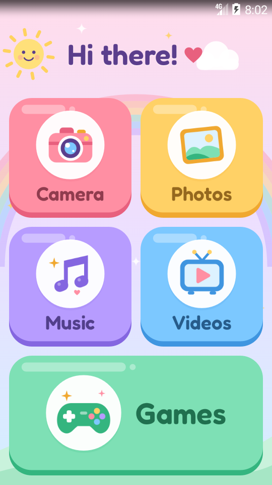
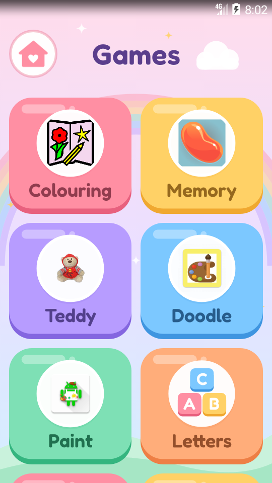

# Kid Launcher

A cheerful, simple home screen for a young child (about 4-7) on an old Android phone,
from KitKat 4.4 (API 19) up. Big candy-coloured tiles, a picture on every tile, one easy
word under it, and nothing else to tap into by accident.

<p>


</p>

It was written for a five-year-old's Galaxy S4 mini VE (GT-I9195I, stock Android 4.4.4), and
it shows: no AndroidX, no Compose, plain framework Views in Java, and a ~180 KB APK.

- **No permissions at all.** No network, no storage, no analytics, no ads, no tracking.
- **No library dependencies.** AndroidX dropped API 19 in 2024 and Compose needs API 21.
- **Whitelist only.** An app gets a tile only if it is on the list in `KidApps.java`, so a
  child never stumbles into Settings, the Play Store or a browser.
- English and Dutch, following the phone's language.

## What is on it

The **home screen** has Camera, Photos, Music and Videos, plus a wide **Games** tile. They point
at Samsung's stock apps; on a phone without them, Camera, Photos and Music fall back to whichever
built-in app does that job. A tile whose app is missing simply does not appear.

**Games** opens a scrolling page of games, each shown with its own icon, so a child recognises
it from inside the game. Back, Home or the big house button return. The default list starts with
the four learning games from [Kids STEM Games](https://github.com/Foadsf/kids-stem-games), made
alongside this launcher, followed by twelve FLOSS kids' games from F-Droid. All of them run on
API 19:

| Tile | App | Package |
|---|---|---|
| Robot | [Robot Path](https://github.com/Foadsf/kids-stem-games/tree/main/robot-path): a first coding game | `io.github.foadsf.robotpath` |
| Patterns | [Pattern Machine](https://github.com/Foadsf/kids-stem-games/tree/main/pattern-machine): what comes next? | `io.github.foadsf.patternmachine` |
| Hops | [Kangaroo Hops](https://github.com/Foadsf/kids-stem-games/tree/main/kangaroo-hops): counting on a number line | `io.github.foadsf.kangaroohops` |
| Balance | [Balance Scale](https://github.com/Foadsf/kids-stem-games/tree/main/balance-scale): equality with fruit | `io.github.foadsf.balancescale` |
| Colouring | Coloring Book | `eu.quelltext.coloring` |
| Memory | Candy Memory | `se.tube42.kidsmem.android` |
| Teddy | Nounours and friends | `ca.rmen.nounours` |
| Doodle | Doodle Dudette | `ardash.doodledudette` |
| Paint | Acrylic Paint | `anupam.acrylic` |
| Letters | LetterBox (drawn as ABC blocks: its own icon is the Android placeholder) | `ch.cryptobit.letterbox` |
| Counting | 12345 - Learn Counting | `eu.quelltext.counting` |
| Pairs | Memo Game (Privacy Friendly) | `org.secuso.privacyfriendlymemory` |
| Train | Li-Ri | `org.liri.liri` |
| Pinball | Vector Pinball | `com.dozingcatsoftware.bouncy` |
| Blocks | 1010! Klooni | `dev.lonami.klooni` |
| Quiz | Primary | `com.quaap.primary` |

Kid Launcher does not bundle, download or install any of them. A game you install later does
**not** appear until you add it to `GAME_LIST`; that is the whitelist doing its job.

## The grown-up exit

**Hold the top-right corner of the home screen (right of the greeting) for 3 seconds.** After
1 second a thin ring starts to fill. At 3 seconds a dialog asks a two-digit sum such as
`14 + 7`. The right answer opens a parent menu:

- **Open Settings**
- **Open the normal home screen**: the phone's own launcher. Pressing Home comes back here.
- **Change the default home app**: the system's home picker where there is one, otherwise this
  app's info page, where *Clear defaults* makes Android ask again on the next Home press.

A tap, a brushing finger, a second finger, or a finger that slides off the corner cancels the
hold. A wrong answer gets a new sum, and both dialogs close themselves after 30 seconds. Back
does nothing on the home screen, and there is no PIN to forget.

What it cannot do: without root or device-owner rights, no launcher can block the notification
shade or the recent-apps list. A determined child can still reach Settings from the shade.

## Build

Needs JDK 17+ (21 is used) and an Android SDK with `platforms;android-35` and
`build-tools;37.0.0`.

```bash
./gradlew assembleDebug lintDebug
```

To greet a child by name (`Hi Mia!`, and the app is labelled *Mia's Home*):

```bash
./gradlew assembleDebug -PkidName=Mia
```

Without `kidName` the greeting is *Hi there!* and the label *Kid Launcher*. The APK lands in
`app/build/outputs/apk/debug/app-debug.apk`. Gradle 9.8.1 (checksum-verified) and AGP 9.4.1 are
pinned in `gradle/wrapper/gradle-wrapper.properties` and `gradle/libs.versions.toml`.

`lintDebug` **fails the build on any API call newer than 19**. Such a call otherwise compiles
fine and only crashes on the phone.

**Signing:** a `debug.keystore` next to `settings.gradle.kts` (gitignored) is used for debug
builds if present, so builds from several machines can update the same installed copy.

## Install

Make it the home screen on the phone itself. Install the APK, press **Home**, choose
**Kid Launcher** (or *Mia's Home*), then **Always**. Installing any new home app makes Android ask
again, so the first Home press after installing shows the chooser.

```bash
adb install -r app/build/outputs/apk/debug/app-debug.apk
```

Old phones often have flaky USB. `tools/install.sh APK SERIAL` pushes the file first and then
installs it **on the phone**, so the install finishes even if the cable drops right after the
push. It retries a bounded number of times and only reports success once `pm path` finds the
package. With no working USB at all, send the APK over Bluetooth or copy it to a microSD card.
Then allow *Settings → Security → Unknown sources* and tap the file.

## Verify on a device

`tools/verify_on_device.py` drives the installed launcher over adb and checks what it does:

- the home screen shows exactly the whitelisted tiles, and each one starts its app;
- the Games screen shows exactly the whitelisted games that are installed, and each one starts;
- the parent gate ignores a tap and a 1 s hold, asks a sum after 3.5 s, refuses a wrong answer,
  and opens the menu and Settings for the right one.

Success is judged by window focus and UI dumps, not by adb exit codes. The script starts the
launcher explicitly and never makes it the default home.

```bash
python3 tools/verify_on_device.py --serial SERIAL --shots /tmp/shots
```

KitKat's adbd has no `exec-out`, so the script captures screenshots on the device and pulls them.
All of it passes on an API 19 x86 emulator shaped like the S4 mini (540×960, 240 dpi), with the
twelve F-Droid games installed.

## Changing things

| To change | Edit |
|---|---|
| Home tiles, or which games appear and their order | `KidApps.HOME` / `KidApps.GAME_LIST` in `app/src/main/java/.../KidApps.java` |
| The child's name | `-PkidName=…` at build time |
| Tile words | `res/values/strings.xml` (and `values-nl/`) |
| Colours | `res/values/colors.xml`, and the palette at the top of `tools/gen_icons.py` |
| Icons | `tools/gen_icons.py`, then `python3 tools/gen_icons.py` |
| Background | `SkyView.java` |
| Font | `tools/make_font.sh` (needs `fontTools`) |

Picking games for an old phone? Look in F-Droid's index, not your memory. The `minSdkVersion`
and native ABIs of each build are listed there, and the
[archive repo](https://f-droid.org/archive/) keeps the older builds that still run on API 19.

## Design notes

- In portrait, tiles are about 162×160 dp in a 2-column grid, with Games spanning the last row.
  In landscape the home screen has 3 columns and the Games screen 4.
- Pressing a tile pushes it down onto its darker lip and shrinks it slightly. Letting go springs
  it back with an overshoot. The app opens 160 ms later, so the bounce is visible, and taps in
  the next 1.5 s are ignored.
- Tiles pop in one by one on each return home, and every 7-12 s one picture gives a small
  wiggle. The background is static, so an idle home screen costs no power.

## Licence

GPL-3.0, see [`LICENSE`](LICENSE). The bundled Fredoka font is under the SIL Open
Font License 1.1, see [`licenses/`](licenses/README.md). Everything else, including every
icon and the background, is original to this project and drawn as code.
